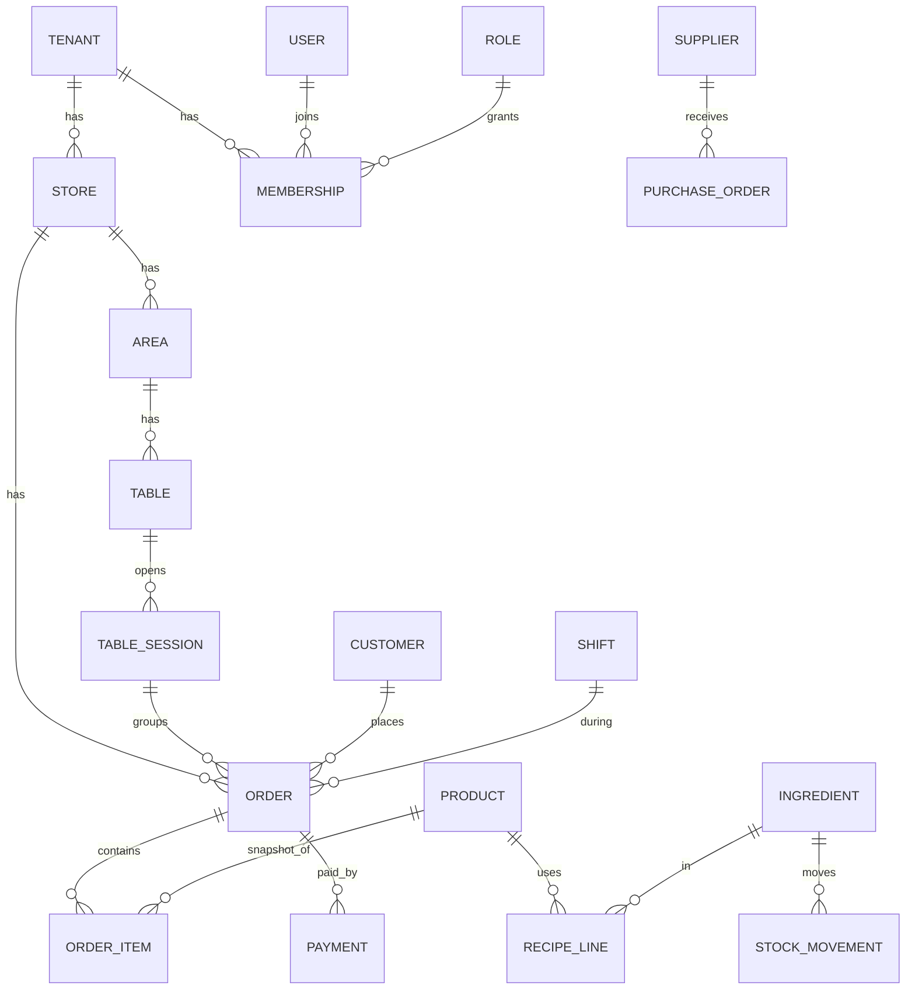

# 03. Mô hình dữ liệu (PostgreSQL)

Quy ước: PK `id uuid`; `tenant_id` trên mọi bảng nghiệp vụ; `store_id` nếu theo chi nhánh;
`created_at/updated_at`; tiền = `bigint` VND; xoá mềm `deleted_at` cho danh mục.
Mọi bảng có RLS theo `tenant_id`.

## Tổng quan quan hệ

## Theo phân hệ

### 12. Administration & Control (nền tảng)
`tenant(id, name, plan, status)`, `store(id, tenant_id, name, address, tax_code, timezone, settings jsonb)`,
`user(id, phone, email, password_hash, full_name)`, `role(id, tenant_id, name, is_system)`,
`permission(code)`, `role_permission(role_id, permission_code)`,
`membership(id, user_id, tenant_id, store_id null=toàn tenant, role_id, status)`,
`audit_log(id, tenant_id, store_id, actor_id, action, entity, entity_id, before jsonb, after jsonb, ip, at)`,
`approval_request(id, type, payload, requested_by, status, decided_by)`, `notification(...)`, `device(user_id, push_token, kind)`.

### 9. Menu & Product
`category(id, store_id|tenant_id, name, sort)`, `product(id, category_id, name, description, image_url, base_price, tax_rate, station_id, is_active, is_sold_out)`,
`option_group(id, product_id, name, min, max)`, `option(id, group_id, name, price_delta)` (size/topping),
`combo`, `combo_item`, `price_rule(product_id, store_id, days, time_from, time_to, price)`, `sale_schedule`.
`station(id, store_id, name, kind: kitchen|bar)` để phân tuyến món.

### 2. Table & Floor
`area(id, store_id, name)`, `table(id, area_id, code, seats, status, qr_token_version, pos_x, pos_y)`,
`table_session(id, table_id, opened_at, closed_at, guest_count)`, `table_transfer(order_id, from_table, to_table, by, at)`,
`reservation(id, store_id, customer_name, phone, party_size, at, status, table_id)`.

### 1 & 3. POS, Order, QR
`order(id, store_id, table_session_id, channel: dine_in|takeaway|delivery|qr, status, customer_id, shift_id, subtotal, discount, tax, total, code, note, created_by)`,
`order_item(id, order_id, round_no, product_id, name_snapshot, unit_price_snapshot, qty, options_snapshot jsonb, note, status, station_id, placed_by, cancel_reason)`,
`order_adjustment(order_id, kind: discount|surcharge|voucher, amount, reason, approved_by)`,
`bill_split(order_id, ...)`, `refund(id, payment_id, amount, reason, approved_by)`,
`service_call(id, table_id, kind: staff|water|bill, status)`.

### 4. Kitchen & Beverage
Dùng `order_item.station_id/status` + `kitchen_ticket(id, station_id, order_id, status, accepted_at, ready_at)` và `item_issue(order_item_id, kind: out_of_stock|error, note)`.

### 5. Inventory & Ingredient
`ingredient(id, tenant_id, name, unit, min_stock)`, `recipe_line(product_id, option_id null, ingredient_id, qty)`,
`stock_lot(id, store_id, ingredient_id, qty, unit_cost, expiry)`,
`stock_movement(id, store_id, ingredient_id, kind: receive|sale|waste|adjust|transfer, qty, ref_type, ref_id, unit_cost, at)` — sổ kho append-only; tồn = tổng movement,
`stocktake(id, store_id, status)`, `stocktake_line(...)`, `waste_record(...)`.

### 11. Purchasing & Supplier
`supplier(id, tenant_id, name, tax_code, contact)`, `purchase_request`, `purchase_order(id, store_id, supplier_id, status, total)`, `purchase_order_line`,
`goods_receipt(id, po_id, received_by, qc_note)`, `goods_receipt_line`, `supplier_payable(id, supplier_id, amount, due_date, status)`, `supplier_payment`.

### 6. Staff & Shift
`staff_profile(membership_id, position, hourly_rate, hired_at)`, `work_shift_template`, `schedule(id, store_id, staff_id, starts_at, ends_at)`,
`attendance(id, staff_id, check_in, check_out, source)`, `shift_swap_request`, `leave_request`, `task`, `performance_review`.

### 7. Cashier & Cash
> Lưu ý: VietQR xác nhận thủ công (`payment.confirmed_by`, `confirmed_at`). `e_invoice` là bảng dành sẵn, CHƯA triển khai (tạm bỏ qua).

`cash_shift(id, store_id, cashier_id, device_id, opened_at, closed_at, opening_cash, expected_cash, counted_cash, variance, status)`,
`cash_movement(id, cash_shift_id, kind: in|out, amount, reason, approved_by)`,
`payment(id, order_id, cash_shift_id, method: cash|vietqr|bank_transfer|other, amount, status, provider, provider_txn_id null unique, qr_payload, confirmed_by, confirmed_at, paid_at, idempotency_key unique)`,
`payment_event(id, payment_id, raw jsonb, received_at)` (lưu webhook thô),
`e_invoice(id, order_id, provider, series, number, lookup_code, status, issued_at, buyer_tax_code, xml_url)`.

### 8. Finance & Analytics
Doanh thu/giá vốn suy ra từ `order`, `payment`, `stock_movement`. Thêm `expense(id, store_id, category, amount, paid_at, note)`, `expense_category`,
và bảng tổng hợp `daily_store_summary(store_id, date, revenue, cogs, orders, ...)` do job tính; `product_daily_stats`.

### 10. CRM & Loyalty
`customer(id, tenant_id, phone, name, birthday, tier_id)`, `loyalty_account(customer_id, points)`, `loyalty_txn(account_id, points, order_id, kind)`,
`tier`, `voucher(id, tenant_id, code, type, value, min_order, valid_from, valid_to, usage_limit)`, `voucher_redemption`, `promotion(id, rule jsonb, ...)`,
`feedback(order_id, customer_id, rating, comment)`.

## Chỉ mục và ràng buộc quan trọng
- `payment(provider, provider_txn_id)` unique; `payment(idempotency_key)` unique.
- `order(store_id, status, created_at)`, `order_item(station_id, status)` cho KDS.
- `stock_movement(store_id, ingredient_id, at)`.
- Một `table` chỉ có tối đa một `table_session` đang mở (partial unique index).
- Mã đơn tăng dần theo `store_id` + ngày (bảng `sequence`).

## Phase mapping
Phase 1: 12 (một phần), 9, 2, 1, 3, 4, 7 (payment). Phase 2: 5, 11, 6, 7 (ca/quỹ), 8. Phase 3: 10, đa chi nhánh, approval, dự báo. Phase 4: web admin.
Toàn bộ bảng được thiết kế sẵn để migration thêm dần không phá cấu trúc.

## Bổ sung từ tài liệu nghiệp vụ (docs/business)
- `store`: thêm `business_day_cutoff`, `price_includes_tax`, `service_charge_rate`, `discount_limit_pct`, `qr_confirm_mode`, `bank_account` (VietQR), `service_mode` (table|counter|both).
- `tenant`: thêm `business_type` (household|company), `tax_regime`.
- `tax_rate_history(tenant_id|store_id, product_id|null, rate, valid_from, valid_to)`: thuế suất theo ngày bán.
- `order`: thêm `business_date`, `queue_no` (số thứ tự quầy), `invoice_requested`, `invoice_buyer jsonb` (MST/tên/địa chỉ, xử lý sau), `version` (khoá lạc quan).
- `order_item`: thêm `qty numeric(10,3)`, `unit`, `voided_by`, `approved_by`, `cost_snapshot`.
- `order_adjustment.kind`: `discount|surcharge|service_charge|comp|rounding`.
- `payment`: thêm `tip_amount`, `received_amount`, `change_amount`, `bank_txn_ref`, `kind` (sale|deposit|overpayment).
- `guest_session(id, table_session_id, created_at, expires_at)`; `order_item.placed_by_guest`.
- `approval_request` gắn `requested_by`, `approved_by`, `reason`, `entity`.
- `print_job(id, store_id, printer_id, kind: ticket|label|bill, ref_id, status, attempts)`; `printer(id, store_id, name, address, paper_width, station_id)`.
- `device(id, store_id, kind: pos|kds|phone, last_seen_at)`.
- `sequence(store_id, scope, date, value)` để sinh mã đơn/ số thứ tự.
- `unit_conversion(ingredient_id, from_unit, to_unit, factor)`; `recipe_line.yield_pct`.
